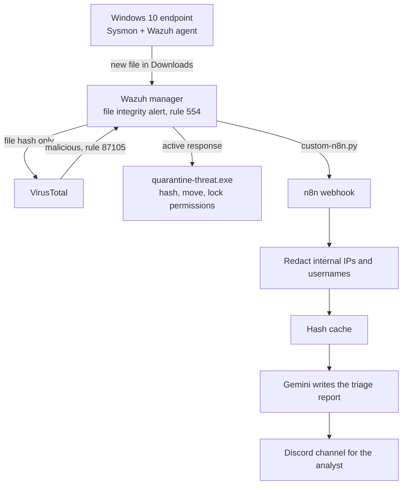
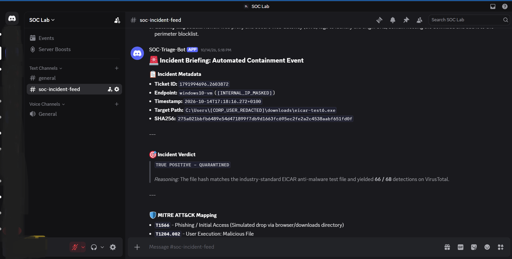

# wazuh-ai-soc-pipeline

A lab project that automates the first steps of handling a malicious download: Wazuh detects the file, a custom program quarantines it without destroying the evidence, and an LLM writes an incident report that reaches the analyst in Discord.

Built and tested on two VMs with the EICAR test file. No real malware was used.

## How it works

1. **Detect:** Sysmon logs process activity, and Wazuh watches the two Downloads folders in real time.
2. **Check:** the file's hash (never the file) is sent to VirusTotal.
3. **Contain:** on a malicious verdict, Wazuh runs `quarantine-threat.exe` on the endpoint. It hashes the file, moves it to a locked folder as `<sha256>.locked`, and restricts access to SYSTEM and Administrators. The file is preserved, not deleted.
4. **Triage:** the same alert goes to n8n, which masks internal IPs and usernames, checks a hash cache, and has Gemini write an incident report mapped to MITRE ATT&CK.
5. **Inform:** the report is posted to a Discord channel for an analyst to read and decide what to do.

## Evidence

More screenshots are in `docs/screenshots/`, one folder per phase. `PROGRESS.md` is the full build log, including the bugs and dead ends.

## Stack
Wazuh 4.12 · Sysmon (SwiftOnSecurity config) · VirusTotal API · Python + PyInstaller · n8n in Docker · Google Gemini API · Discord bot · VMware Workstation (Windows 10 + Ubuntu)

## Design decisions
- **Quarantine, don't delete:** keeps the sample and its SHA256 for investigation.
- **Hash lookups only:** the file never leaves the endpoint, so sensitive files aren't uploaded anywhere.
- **Redaction before the LLM:** internal IPs and usernames are masked before anything goes to a cloud API.
- **The LLM only writes text.** It can't run commands. Containment is fixed logic triggered by a Wazuh rule.

## Repo layout
- `agent-windows/` quarantine script and Sysmon config
- `wazuh-manager/` forwarder script and a redacted config extract
- `n8n-workflows/` exported workflow (credentials removed)
- `docs/screenshots/` evidence

## Known limitations
- Quarantine is automatic with no human approval, and I haven't verified how many VirusTotal detections trigger it, so a low-count false positive could move a legitimate file.
- No host isolation or response buttons. I tried both (see `PROGRESS.md`) and scoped them out, so the analyst's decision point is the report. Analyst-approved response actions are future work.
- A hash lookup only recognizes files VirusTotal has already seen, so brand-new malware would come back as "no record".
- Windows Defender exclusions on the monitored folders were needed so Defender didn't delete test files first. That weakens that endpoint.
- The report is LLM-generated and can be wrong (one said the host was "isolated" when only the file was quarantined). A real deployment would ground it in a playbook.
- Data leaving the network: only the hash goes to VirusTotal. A redacted alert (hostname, file name and path, hash, detection counts) goes to Gemini, where free-tier terms allow Google reviewers to read inputs. The report goes to Discord, a consumer chat app. Production would use a paid or enterprise AI agreement and approved channels.
- The n8n webhook has no authentication (acceptable on a lab network, not in production), and the quarantine script doesn't record the original file's timestamps or owner.
- The n8n hash cache only persists once the workflow is published.

## Secrets
All keys and tokens in this repo are placeholders (`YOUR_...`).